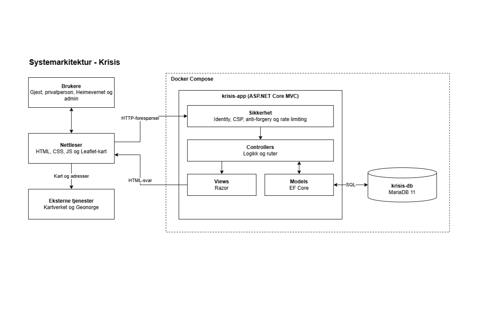

# Dokumentasjon

## Drift

Docker Desktop må være installert og åpent. Sett sterke, forskjellige passord lokalt for database-root og appbrukeren; ikke legg dem i Git. I PowerShell:

```powershell
$env:MYSQL_ROOT_PASSWORD = '<strong-root-password>'
$env:DB_APP_PASSWORD = '<different-strong-app-password>'
docker compose up --build
```

Bytt ut plassholderne med tilfeldige passord, helst 64 heksadesimale tegn generert i en passordbehandler. Compose-filen setter appen i utviklingsmodus og er kun for lokal utvikling. Åpne `http://localhost:8080`. Docker starter webappen og MariaDB; appen og databasen publiseres bare på loopback. Appen kobler til databasen med den dedikerte `krisisapp`-kontoen, som kun får SELECT/INSERT/UPDATE/DELETE på `krisisdb`.

- Stoppe appen: `docker compose down`
- Nullstille databasen: `docker compose down -v`, deretter `docker compose up --build`

Init-skriptene og brukerrettighetene kjøres bare når MariaDB-volumet opprettes første gang. For en eksisterende database må databaseansvarlig ta sikkerhetskopi, opprette/oppdatere `krisisapp` med passordet i `DB_APP_PASSWORD`, gi den bare SELECT/INSERT/UPDATE/DELETE på `krisisdb`, og kjøre `Data/sql/identity.sql`, `Data/sql/submission-identity-owner.sql`, `Data/sql/resource-drafts.sql` og `Data/sql/submission-kommune.sql` i den rekkefølgen. Ikke slett volumet for å få nye sikkerhetsendringer; det sletter alle data.

## Systemarkitektur

Appen er bygget med ASP.NET Core MVC. Viewene (HTML, CSS, JS) sender forespørsler til controllerne, og controllerne bruker modellene til å lese og lagre data i databasen.



- `FormController`: skjemaet for å tilby en ressurs, i tre steg: tegne på kartet, fylle ut detaljer og oppsummering. Ved innsending lagres alt i databasen, og brukeren får en kvittering. Kommunen hentes automatisk fra Kartverket for midtpunktet av det som er tegnet, og feltet er tomt hvis oppslaget feiler eller punktet er utenfor Norge.
- `ResourcesController`: viser alle innsendinger fra databasen.
- `AdminController`: gir Admin- og Heimevernet-brukere oversikt over og administrasjon av alle innsendinger, og matching av behov med ressurser på `/Admin/Kobling`. Siden lister åpne behov med detaljer, og "Finn ressurs" åpner `/Admin/Kobling/{id}` med et kart over behovet og de ledige ressursene. Koordinatene vises på hvert kort, og for tegnede områder er de midtpunktet. Forslaget for et behov er nærmeste ledige ressurs i samme kategori, der høyest prioritet velger først. Koblingen gjøres alltid manuelt, og brukeren kan velge en annen ledig ressurs enn forslaget. Koblinger lagres i `Requests`, og begge meldingene får status `tildelt`. `/Admin/Kobling/arkiv` viser alle koblinger med behov, ressurs og status, og filtrerer på tildelt og løst. Der setter "Marker som løst" behovet og ressursene som er koblet til det, til `lost`. Siden viser lagrede felt for begge parter, med navn, e-post og telefon til den som publiserte. Admin og Heimevernet kan se denne kontaktinformasjonen. Admin-sidene er en portal med samme toppmeny som resten av appen, men egne menypunkter, og Admin og Heimevernet sendes dit etter innlogging. Oversikten på `/Admin` kan filtreres på kommune og type, og "Skriv ut" gir en ressursliste for valgt kommune. Admin kan rette kommunen på en melding under Rediger.
- `AccountController`: registrering, innlogging og utlogging via ASP.NET Core Identity, samt profiloversikt og redigering av egne meldinger. Når en melding blir koblet, ser privatbrukeren et merke i menyen og en beskjed på Min side med tittelen på det meldingen er koblet til. Kontaktinformasjon til den andre parten vises ikke. Merket forsvinner når meldingen er markert som løst. Passord lagres med Identity sin passordhasher.
- `ErrorController`: feilside.

**Database:** MariaDB 11. Identity lagrer kontoer og roller i `AspNetUsers`/`AspNetRoles`; innsendinger og kartdata bruker de eksisterende `Submissions`/`Points`-tabellene.

### Tilgangskontroll

Ressurslisten og kartet kan leses offentlig. Hele skjemaet for å opprette en innsending krever innlogging. Nye kontoer får automatisk Identity-rollen `Privatperson`; offentlig registrering kan ikke velge eller gi `Admin` eller `Heimevernet`. Admin-oversikten og endring/sletting av innsendinger er begrenset til Identity-rollene `Admin` og `Heimevernet`. Endepunkter som kun er for administratorer kan bruke `[Authorize(Policy = AppRoles.AdminOnly)]`. Tildeling av privilegerte roller må gjøres av en betrodd driftsansvarlig, ikke gjennom registreringsskjemaet.

Innlogging bruker Identity-cookies, og mislykkede passordforsøk låser kontoen midlertidig etter fem forsøk. MVC validerer anti-forgery-token på alle usikre HTTP-metoder.

Identity-kontoer kobles til nye innsendinger gjennom `Submissions.IdentityUserId`; den eldre `Submissions.UserId`-kolonnen er fortsatt en nullable heltallsreferanse til legacy `Users`. Profilen viser bare den innloggede brukerens egne innsendinger og utkast. Utkast lagres i `ResourceDrafts` ved hvert steg i skjemaet og kan fortsettes etter ny innlogging eller fra en annen enhet. Innsendingseiere kan redigere egne detaljer, men ikke endre status, type eller kartområde. Den offentlige ressurslisten er skrivebeskyttet. Den rollebeskyttede admin-oversikten kan redigere alle innsendinger; type kan ikke endres hvis innsendingen allerede inngår i en forespørsel. Sletting fjerner først tilhørende forespørsler og sletter deretter innsendingen; kartpunkter slettes via databasens kaskaderegel.

Identity bruker `AspNetUsers`, `AspNetRoles` og tilhørende tabeller. `Data/sql/identity.sql` oppretter disse uten å endre de eksisterende `Users`- og `Roles`-tabellene. `Submissions.IdentityUserId` lagrer eierens ASP.NET Identity-ID og peker på `AspNetUsers`; `Submissions.UserId` er fortsatt bare for den eldre kontomodellen. Privilegerte roller kan bare gis av en betrodd databaseansvarlig: registrer den valgte kontoen først, velg rollen i spørringen under, kjør den én gang, og kontroller at nøyaktig én rad ble lagt til. Registreringsskjemaet kan ikke velge eller gi privilegerte roller. Eksempelet gir rollen `Admin`; rollen `Heimevernet` opprettes også automatisk ved oppstart og kan tildeles på samme måte.

```sql
INSERT INTO AspNetUserRoles (UserId, RoleId)
SELECT u.Id, r.Id
FROM AspNetUsers u
JOIN AspNetRoles r ON r.NormalizedName = 'ADMIN'
WHERE u.NormalizedEmail = UPPER('admin@example.com')
  AND NOT EXISTS (
      SELECT 1
      FROM AspNetUserRoles ur
      WHERE ur.UserId = u.Id AND ur.RoleId = r.Id
  );
```

### Validering av inndata

Skjemaer valideres på serveren med Data Annotations og `ModelState`; HTML-attributter gir bare rask tilbakemelding i nettleseren og erstatter ikke servervalidering. Innsendte kategorier må finnes i databasen, filterverdier og datoer er begrenset, og kartpunkter må være gyldig JSON med gyldige koordinater og et begrenset antall punkter.

### Beskyttelse mot SQL-injeksjon

Databaseforespørslene i appen bruker Entity Framework Core med LINQ, som sender brukerdata som SQL-parametere. Fortsett å bruke LINQ (`Where`, `FindAsync` og lignende) i stedet for å bygge SQL-strenger med brukerdata. For eksempel er søket i `ResourcesController` parameterisert.

Hvis rå SQL blir nødvendig, bruk `FromSqlInterpolated` eller eksplisitte databaseparametere. Ikke sett brukerdata inn i en SQL-streng som sendes til `FromSqlRaw` eller `ExecuteSqlRaw`. SQL-parametere kan heller ikke brukes for tabell- eller kolonnenavn; slike dynamiske verdier må velges fra en fast tillatt liste.

### HTTP-sikkerhetsheadere

Appen sender en Content Security Policy med en unik nonce for hvert svar, slik at de innebygde skriptene kan kjøre uten å tillate vilkårlige innebygde skript. Policyen begrenser også tillatte ressurser til appen og tjenestene som kart, geokoding, fonter og ikoner bruker. `style-src 'unsafe-inline'` beholdes fordi kartbiblioteket og enkelte visninger setter inline-stiler.

I tillegg sendes `X-Content-Type-Options`, `X-Frame-Options`, `Referrer-Policy` og `Permissions-Policy`. HTTP-forespørsler omdirigeres til HTTPS, og HSTS sendes i produksjon med ett års varighet. Identity- og anti-forgery-cookies krever HTTPS utenfor utviklingsmiljøet; i Development kan localhost bruke HTTP for lokal testing. HSTS aktiveres ikke i utvikling.

I produksjon termineres TLS på en reverse proxy eller lastbalanserer foran appen. Proxyen må sende `X-Forwarded-Proto` og videresende trafikken til appen over et privat nettverk. Konfigurer proxyens IP i `ForwardedHeaders:KnownProxies` (for eksempel miljøvariabelen `ForwardedHeaders__KnownProxies__0=10.0.0.10`). Appen stoler bare på videresendte headere fra loopback og eksplisitt konfigurerte proxy-IP-er; ikke fjern denne tillitsbegrensningen eller eksponer appens HTTP-port direkte til Internett. I produksjon avviser appen HTTP POST/PUT/PATCH/DELETE-forespørsler som kommer frem som klartekst; proxyen må selv håndheve HTTPS på offentlig side og aldri videresende klartekstskjemaforespørsler. Proxyen må bruke et gyldig sertifikat og enten omdirigere offentlig HTTP-trafikk til HTTPS selv, eller konfigurere `ASPNETCORE_HTTPS_PORT=443` slik at appens HTTPS-redirect har riktig målport.

Hvis appen senere får nye eksterne ressurser eller tjenester, må de vurderes og eventuelt legges til i CSP-en i `Program.cs`.

Kestrels `Server`-header er deaktivert, og `Server`/`X-Powered-By` fjernes fra appens svar. En reverse proxy, IIS eller CDN foran appen kan legge til egne identifikasjonsheadere; disse må konfigureres separat.

### Videre sikkerhetstiltak

Innlogging begrenses til 10 forsøk per IP per minutt og registrering til 5 per IP per time. Videresendte klient-IP-er brukes kun når forespørselen kommer fra loopback eller en eksplisitt konfigurert proxy. Begrensningene lagres i minnet per app-prosess; ved flere app-instanser må også proxyen eller en delt rate limiter håndheve grenser. `MySqlConnector` er pinnet til den første versjonen som fikser GHSA-473q-m89c-ghf8 (2.6.1). E-postbekreftelse er bevisst utsatt til en e-postleverandør er konfigurert, så en ny bruker kan logge inn uten å bekrefte e-postadressen.

**Kart:** Leaflet og Leaflet-Geoman brukes til å tegne område eller nål. Det som tegnes lagres som punkter (JSON) og vises igjen på kvitteringssiden.

## Testing

### Automatiske tester (xUnit)

Kjøres med `dotnet test azir-sempro.Tests`.

| Testklasse | Hva den sjekker | Resultat |
|---|---|---|
| `AccountViewModelTests` | Registreringsskjemaet godtar gyldig data og avviser ugyldig e-post, kort passord og tomt fornavn | 4 av 4 bestått |
| `FormViewModelTests` | Standardverdiene i skjemamodellen | 3 av 3 bestått |

### Manuelle tester

| Scenario | Forventet | Resultat |
|---|---|---|
| Fylle ut hele skjemaet og sende inn | Kvittering med riktig tittel og kart | |
| Gå videre fra steg 2 uten tittel eller kategori | Feilmelding, blir på siden | Nettleseren viser «Fyll ut dette feltet», skjemaet sendes ikke. Bestått. |
| Åpne `/Resources` etter innsending | Innsendingen vises i listen | |
| Registrere ny bruker | Bruker lagres, sendes til innlogging | Bruker lagres og sendes til innloggingssiden. Bestått. |
| Registrere med e-post som finnes fra før | Feilmelding | «Denne e-posten er allerede registrert.» vises, ingen ny bruker. Bestått. |

## Kilder

- https://geoman.io/docs/leaflet/modes/draw-mode
- https://kartkatalog.geonorge.no/?organization=Kartverket&type=dataset&theme=Basis+geodata&theme=Befolkning&theme=Friluftsliv&theme=Natur&theme=Samferdsel&theme=Samfunnssikkerhet&theme=Annen&theme=Kyst+og+fiskeri&offset=51&append=true
 
